# Interface design study and operating manual

This document is a corrective study artifact for the resume-site hero. It is not a defense of the rejected work and it is not permission to resume implementation. Its purpose is to replace improvisation with a grounded sequence: visual fundamentals, Refactoring UI tactics, human-computer interaction, advanced composition, and evidence-based evaluation.

The companion [image corpus](images/) contains original SVG diagrams. The diagrams intentionally reuse the site's current colors so each principle is learned in the visual language where it must eventually be applied.

## Prototype outcome

On 2026-08-15, Shawn selected candidate **20D — Type study**. Its shared candidate-20 composition and typographic hierarchy were promoted to the home page as `.hero--selected`; the prototype selector and losing candidates were removed. This records the outcome only, not a claim that the selected design has completed browser or user testing.

## What failed in the previous work

The five rejected candidate-20 variants were not five serious design hypotheses. They changed layout mechanics — rails, overlaps, insets, and surfaces — without first resolving the basic content ranking and alignment.

Specific failures:

1. I treated novelty as variation. A structurally different layout is useful only when it tests a meaningful relationship.
2. I changed too many variables at once. That made it impossible to learn whether alignment, grouping, spacing, or action placement caused the result.
3. I used containers and overlap as decoration before the underlying composition worked in plain grayscale.
4. I performed source and build checks without obtaining real-browser visual evidence. Those checks proved that the variants existed, not that they were designed well.
5. I responded to “something feels wrong” with more CSS instead of first naming and testing the visual conflict.

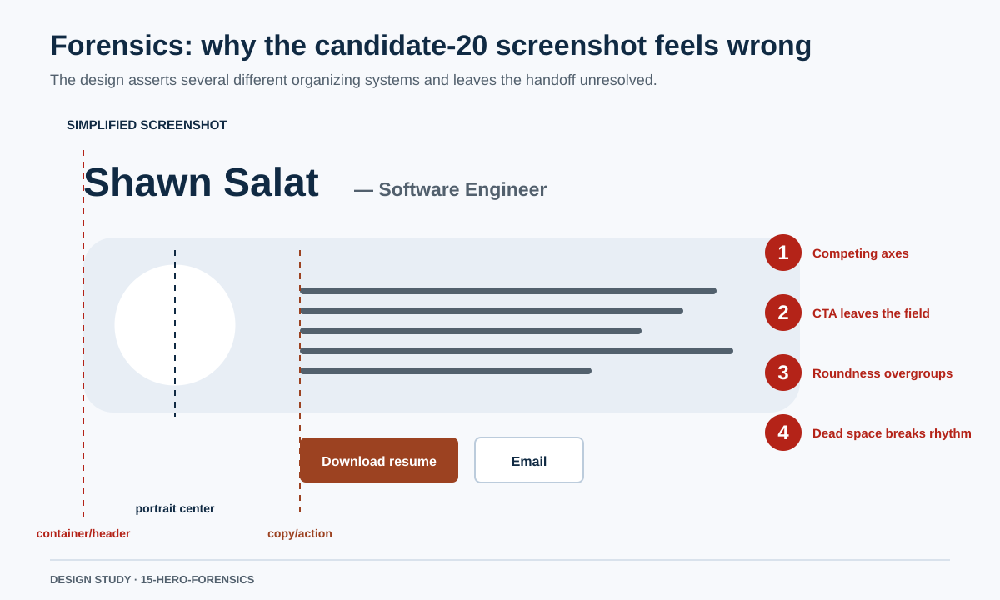

The screenshot’s core problem is not simply that the CTA is outside the capsule. It is that the page establishes three competing anchors: the header/container edge, the portrait center, and the copy/action edge. The highly rounded shared surface strongly groups the portrait and blurb, but the action then exits that group. Finally, the large unassigned gap before Experience interrupts the page’s vertical rhythm.

## Phase 1: visual design fundamentals

### 1. Rank content before styling it

Visual hierarchy is the visible expression of content importance. A designer first decides what should be noticed first, second, and third; only then should size, weight, contrast, color, and spacing encode that order.

For this resume hero, the content jobs are:

1. Identify Shawn and his professional role.
2. Communicate the professional value proposition.
3. Offer the primary resume action and secondary contact action.
4. Add a human, personal layer through the portrait and outside-work sentence.
5. Offer tertiary details such as DOCX and listening activity without competing with the primary path.

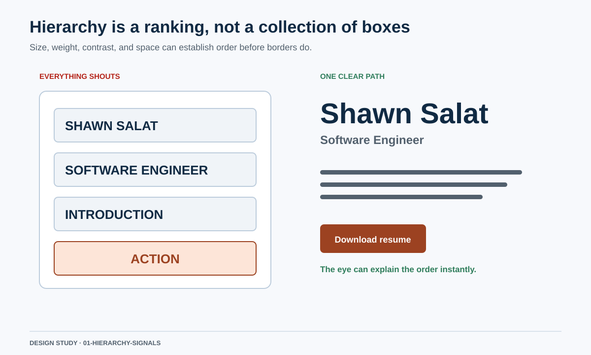

The main diagnostic question is not “does this element need a box?” It is “what rank does this element have, and is that rank visually obvious?”

### 2. Use alignment to expose relationships

Alignment is not merely neatness. Apple’s layout guidance says alignment helps scanning and communicates organization and hierarchy. A strong shared edge tells the reader that elements participate in one sequence. Multiple strong edges are acceptable only when each represents a clear, stable relationship. [Apple Human Interface Guidelines: Layout](https://developer.apple.com/design/human-interface-guidelines/layout)

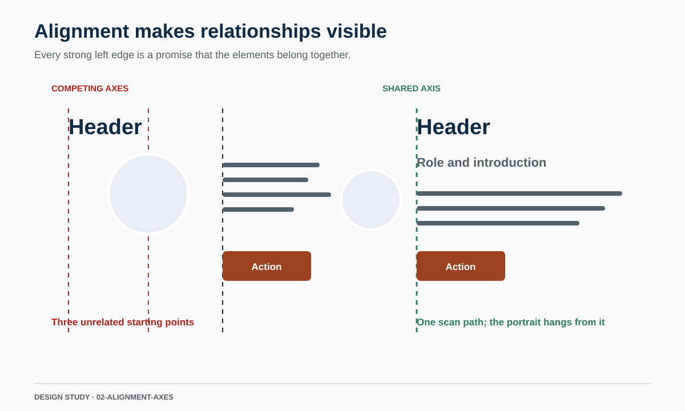

For the hero, the name, professional copy, and action handoff should normally share one dominant text axis. The portrait may hang beside or across that axis, but it should not establish a third, equally forceful organization system.

### 3. Make proximity unambiguous

Gestalt research describes perception as organized forms rather than a neutral inventory of independent visual sensations. Proximity, similarity, and common region cause elements to be perceived as groups before their individual details are read. [Max Wertheimer, “Laws of Organization in Perceptual Forms”](https://psychclassics.yorku.ca/Wertheimer/Forms/forms)

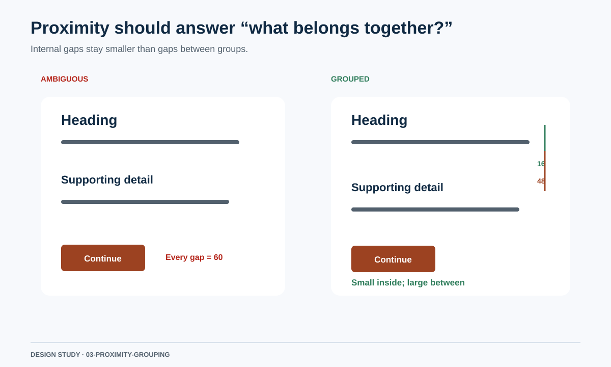

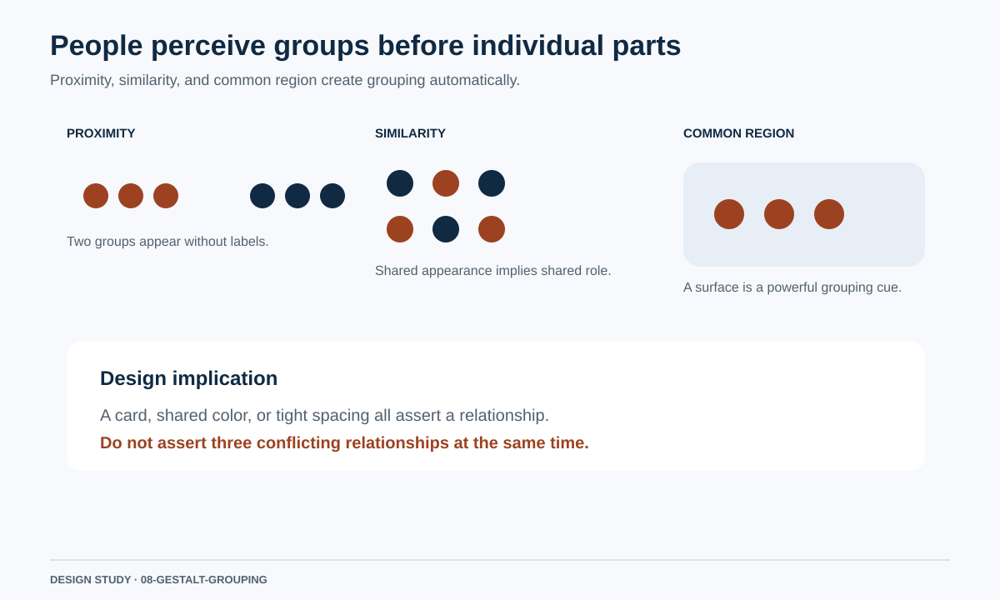

Practical rule: gaps inside a group should be smaller than gaps between groups. A surface, tight spacing, and shared alignment are all grouping signals. Do not make those signals contradict one another.

### 4. Establish rhythm with a spacing scale

Spacing communicates relationship and controls density. A small token set produces repeatable rhythm, while semantic choices determine which token applies. Carbon’s design system uses a spacing scale based on multiples of two, four, and eight to cover tight component relationships and larger layout separation. [Carbon Design System: Spacing](https://carbondesignsystem.com/elements/spacing/overview/)

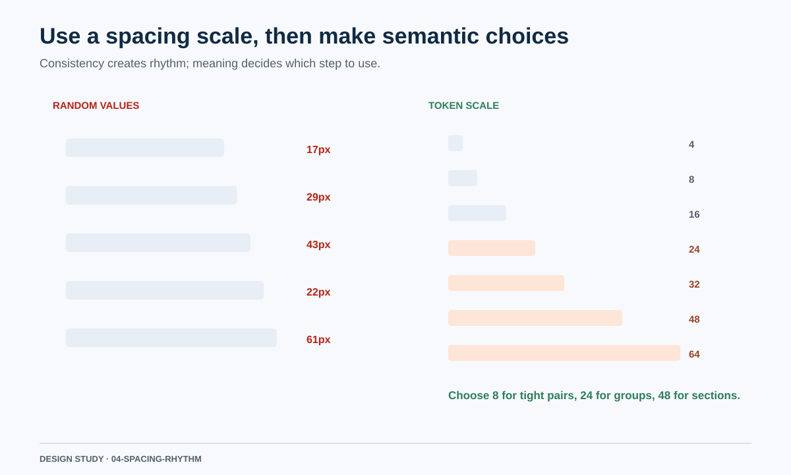

The scale is a constraint, not an excuse to apply the same gap everywhere. Tight label/value pairs, paragraph breaks, card padding, and section transitions require different steps.

### 5. Treat typography as layout

Typography controls hierarchy and the shape of the page. Apple recommends using weight, size, and color to express importance while limiting the number of typefaces. GOV.UK constrains page width to prevent excessively long lines and uses coordinated type and line-height scales to maintain vertical rhythm. [Apple Human Interface Guidelines: Typography](https://developer.apple.com/design/human-interface-guidelines/typography) [GOV.UK Design System: Layout](https://design-system.service.gov.uk/styles/layout/) [GOV.UK Design System: Type scale](https://design-system.service.gov.uk/styles/type-scale/)

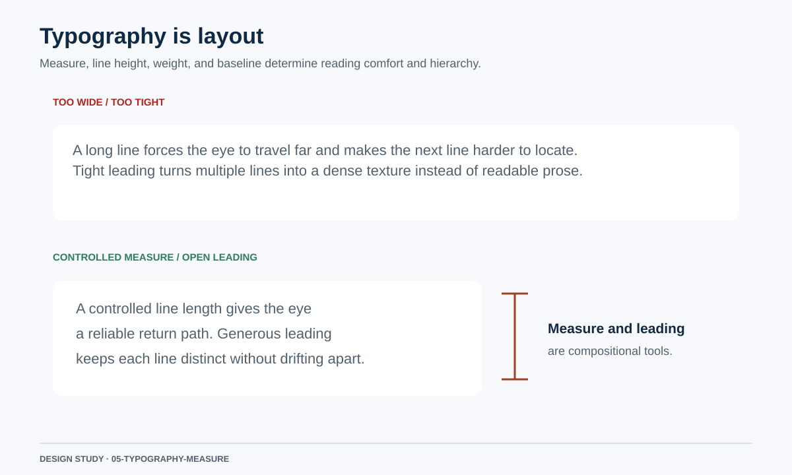

For this site:

- body copy needs a controlled measure rather than expanding to every available pixel;
- role text must be clearly subordinate to the name without becoming visually unrelated;
- multi-line text needs enough leading to remain readable;
- large and small text aligned on one line may need baseline or optical adjustment rather than mechanical centering.

### 6. Use whitespace with purpose

Whitespace can focus attention, separate groups, or create cadence. Space with no perceptible job reads as incompleteness. The Home Office accessibility guidance specifically warns that large empty gaps can create problems for people using strong magnification, while GOV.UK recommends constrained content widths rather than filling the screen. [Home Office: Layout and typography](https://design.homeoffice.gov.uk/accessibility/page-structure/layout-typography) [GOV.UK Design System: Layout](https://design-system.service.gov.uk/styles/layout/)

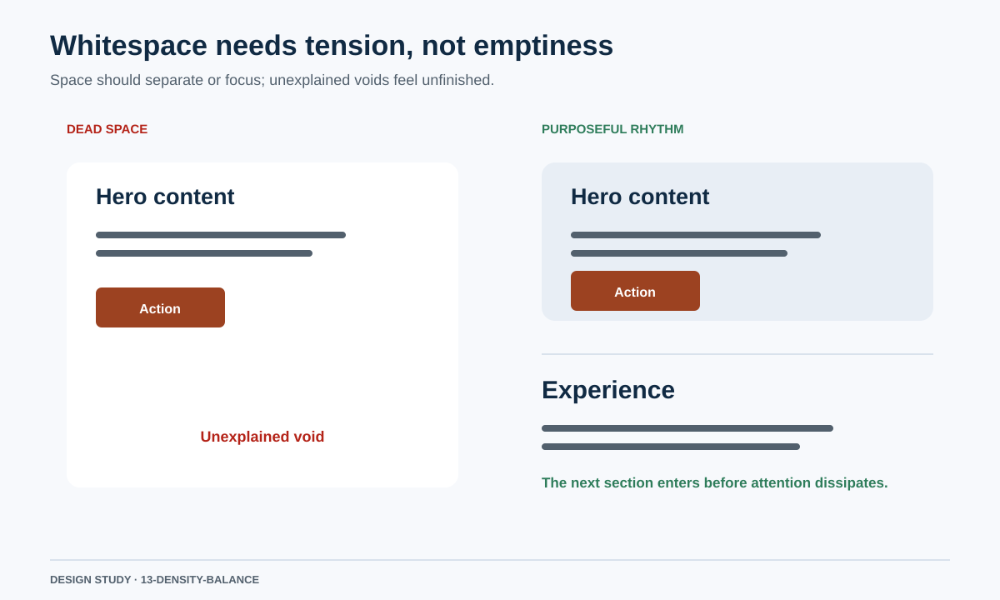

## Phase 2: Refactoring UI

The official Refactoring UI material is especially relevant because it teaches developers to make explicit visual decisions rather than relying on artistic intuition. Its curriculum moves through hierarchy, layout and spacing, text, color, depth, images, finishing, and evaluation. [Refactoring UI](https://refactoringui.com/)

### Relevant tactics

#### Use fewer borders

The official example explains that repeated borders can make an interface busy. It recommends alternatives such as spacing, background contrast, or shadow when they can communicate the relationship more quietly. This does not mean “remove every divider.” It means choose the least forceful cue that still makes the relationship clear. [Refactoring UI](https://refactoringui.com/)

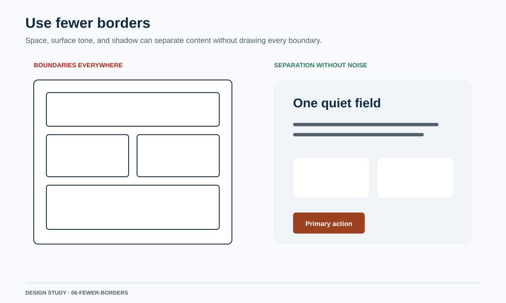

#### De-emphasize to emphasize

Emphasis is relative. If every heading, card, button, and label is strong, no element can dominate. The design should make most elements quieter so the few important elements become obvious without additional decoration.

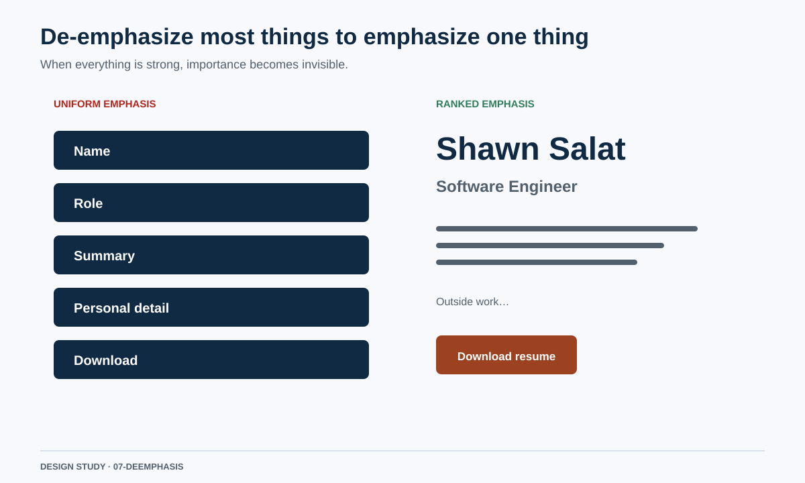

#### Separate visual hierarchy from document hierarchy

Semantic HTML and visual hierarchy solve different problems. Correct headings and source order remain essential, but the visual treatment should express task importance rather than merely assigning a louder box to every semantic section.

#### Avoid ambiguous spacing

If an element sits equally close to two groups, the reader has to infer where it belongs. The candidate-20 CTA had this problem: its alignment suggested the blurb, but its position outside the capsule suggested the page, while the empty space after it weakened both readings.

#### Start with the relationship, not the frame

The right order is content → importance → grouping → alignment → spacing → typography → color/depth. A rounded container is an output of that work, not a substitute for it.

## Phase 3: human-computer interaction

Visual appeal is insufficient. An interface must also support perception, choice, action, feedback, error avoidance, and accessibility.

### 1. Target acquisition

Fitts’s original experiment modeled a speed/accuracy tradeoff for movement between targets of different widths and distances. In interface terms, important or frequent actions should not be tiny, crowded, or needlessly far from the content that motivates them. [Paul Fitts, “The Information Capacity of the Human Motor System in Controlling the Amplitude of Movement”](https://www2.psychology.uiowa.edu/faculty/mordkoff/infoproc/pdfs/Fitts%201954.pdf)

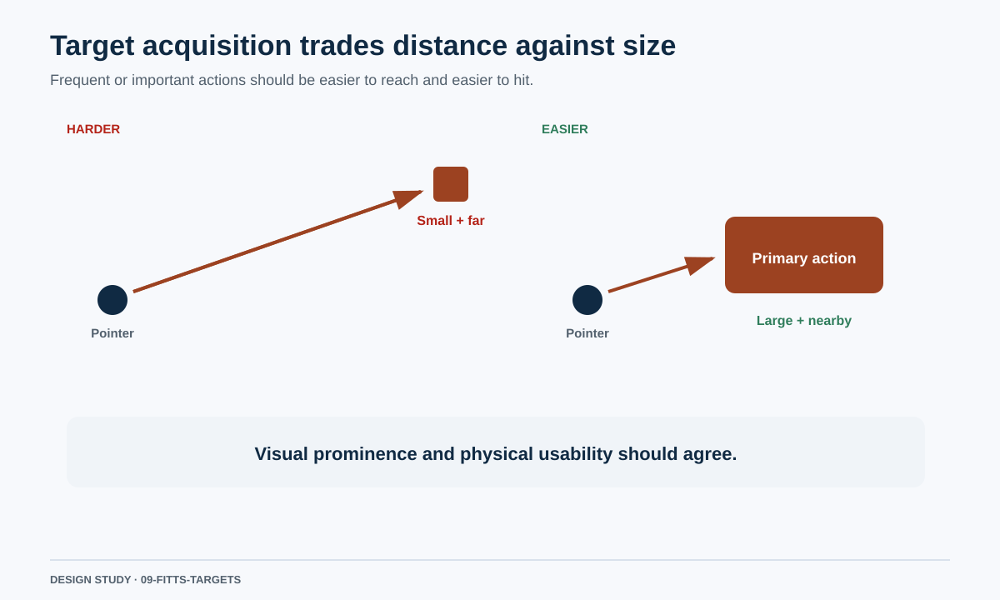

WCAG 2.2 adds a 24-by-24 CSS-pixel minimum target criterion with defined exceptions and a 44-by-44 enhanced criterion. Those are conformance thresholds, not a reason to make primary actions only minimally usable. [WCAG 2.2](https://www.w3.org/TR/WCAG22/)

### 2. Choice and decision time

Hick and Hyman independently connected reaction time with the information carried by a set of possible choices. This does not mean “never show many choices”; it means that a field of equally weighted options imposes more decision work than a clearly prioritized path. [W. E. Hick, “On the Rate of Gain of Information”](https://doi.org/10.1080/17470215208416600) [Ray Hyman, “Stimulus Information as a Determinant of Reaction Time”](https://pubmed.ncbi.nlm.nih.gov/13052851/)

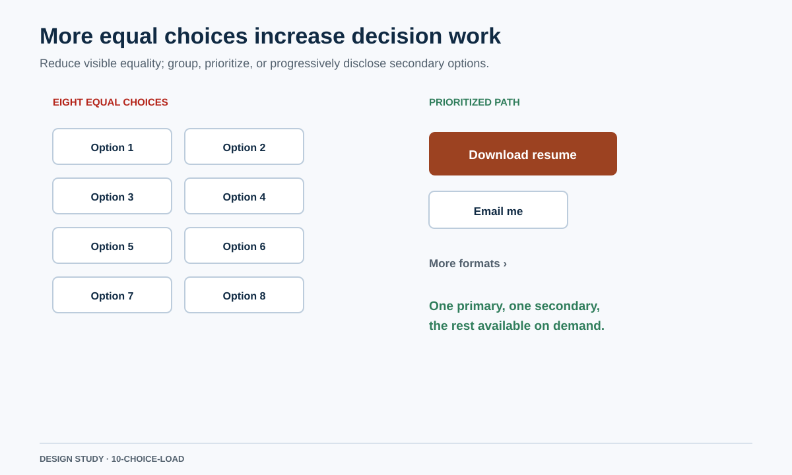

The resume hero should expose one primary action, one clear secondary action, and keep file-format utility visibly tertiary.

### 3. Signifiers, mapping, and feedback

A control needs a perceivable indication that it can be acted on, a label or convention that predicts the result, and feedback that exposes the resulting state. Nielsen’s heuristics emphasize visible system status, language that matches users’ expectations, user control, consistency, recognition, and minimalist presentation. [Nielsen Norman Group: 10 Usability Heuristics](https://www.nngroup.com/articles/ten-usability-heuristics/)

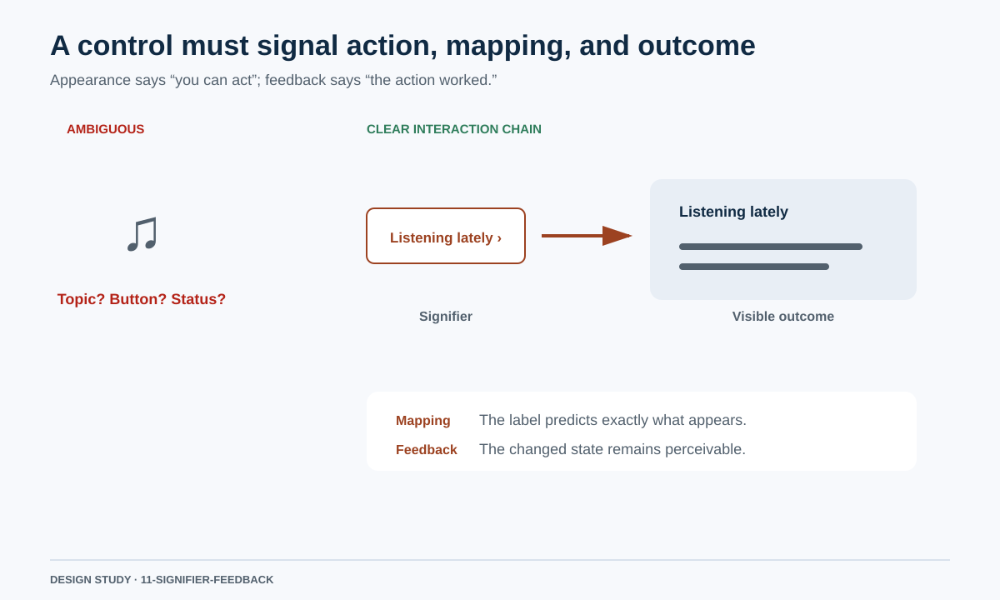

This is why an unlabeled music glyph is weak: it identifies a topic, not an action. “Listening lately” with a disclosure chevron predicts the revealed content and can visibly reflect its expanded state.

### 4. Reading order and responsive behavior

People generally scan from the leading side and top toward the trailing side and bottom, adjusted for language direction. Visual reordering must not contradict keyboard or document order. Apple also recommends adapting layouts while keeping the hierarchy recognizable as windows and text sizes change. [Apple Human Interface Guidelines: Layout](https://developer.apple.com/design/human-interface-guidelines/layout)

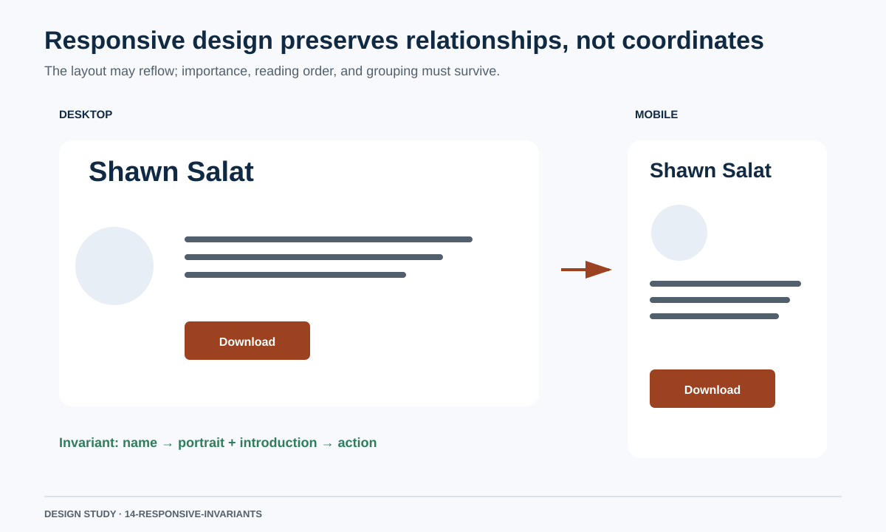

The desktop structure remains header → portrait beside uninterrupted blurb → actions. Mobile may stack those elements, but it must retain the same semantic and focus order.

## Phase 4: advanced interface composition

Advanced design is not adding more effects. It is controlling multiple relationships without losing clarity.

### Optical rather than purely mathematical alignment

Curved shapes, capital letters, and mixed type sizes can appear misaligned even when their boxes are mathematically centered. Grids establish a dependable starting structure, but small visual compensation may be necessary. Refactoring UI explicitly includes baseline alignment as a text-design topic, while Carbon uses an adaptive 2x grid as a shared geometric foundation. [Refactoring UI](https://refactoringui.com/) [Carbon Design System: 2x Grid](https://carbondesignsystem.com/elements/2x-grid/overview/)

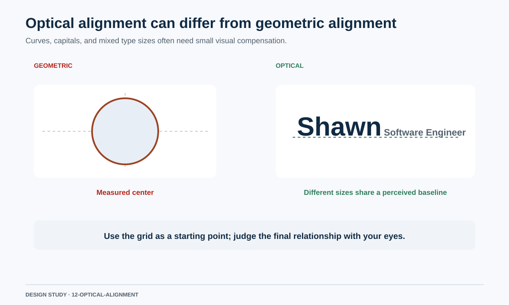

### Composition as balance and tension

A composition can be asymmetric without feeling accidental. The test is whether visual weight is counterbalanced: a large portrait may be balanced by a strong text block; a dark primary button may be balanced by surrounding negative space; an offset element may work when its offset reinforces a clear axis.

Asymmetry fails when it looks like an arithmetic remainder — for example, when a CTA begins at a calculated inset that does not correspond to a visible compositional anchor.

### Depth must communicate a real layer

Apple’s material guidance says depth and material should distinguish functional layers and warns that applying special material throughout content can create a confusing hierarchy. Shadow, overlap, and tonal elevation must therefore explain a layer relationship, not merely make a variant look different. [Apple Human Interface Guidelines: Materials](https://developer.apple.com/design/human-interface-guidelines/materials)

### Responsive invariants

A strong design specifies what must remain true as dimensions change:

- importance order;
- semantic and keyboard order;
- group membership;
- readable measure;
- discoverable actions;
- adequate target size;
- recognizable personality.

Coordinates and column count may change. Those relationships may not.

### Disciplined evaluation

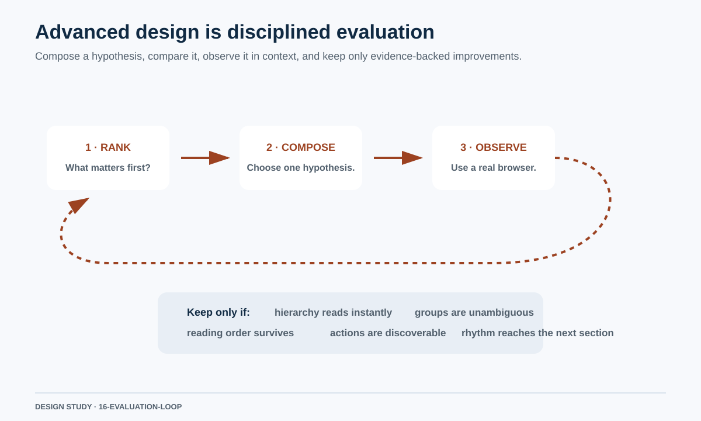

Every future variation must state one hypothesis in plain language. Examples:

- “Aligning the title to the blurb axis will remove the competing scan path.”
- “Keeping the CTA inside the same quiet field will resolve ambiguous group membership.”
- “Reducing the hero-to-Experience transition by one spacing step will preserve page rhythm.”

A variation must not simultaneously change all three and then claim to have learned which one mattered.

## Resume-hero evaluation rubric

Score each item `0` (fails), `1` (uncertain), or `2` (clear). Any zero blocks promotion.

| Area | Review question |
| --- | --- |
| Content ranking | Can a first-time viewer identify name, role, professional value, and primary action in the intended order? |
| Alignment | Is there one dominant text axis, with every other axis having an explainable role? |
| Grouping | Is it immediately clear whether the CTA belongs to the introduction or to the page? |
| Proximity | Are internal gaps smaller than gaps between groups? |
| Typography | Are role, summary, personal detail, and utility text visibly ranked and readable? |
| Measure | Does body copy remain at a comfortable line length? |
| Surface use | Does every background, border, radius, shadow, or overlap communicate a real relationship? |
| Action hierarchy | Is Download primary, Email secondary, and DOCX tertiary without becoming obscure? |
| Rhythm | Does the hero hand off to Experience without a dead void or collision? |
| Interaction | Are actions discoverable, large enough, keyboard reachable, and visibly focused? |
| Responsive behavior | Does the hierarchy survive at desktop, narrow mobile, text zoom, and reduced motion? |
| Evidence | Was the actual rendered page inspected in a real browser rather than inferred from source/build success? |

## Required process before another hero iteration

1. Return to the last user-approved or promising baseline; do not build on rejected novelty.
2. Render the content in grayscale without a capsule, shadow, overlap, or accent color.
3. Establish the importance order and one dominant text axis.
4. Check grouping using proximity alone.
5. Add at most one surface if it clarifies a relationship that space cannot.
6. Add typography, then color, then depth in that order.
7. Create no more than three variants, each testing one named hypothesis.
8. Compare each variant to the baseline at the same viewport and content state.
9. Inspect desktop, mobile, expanded music disclosure, focus, and text zoom in a real browser.
10. Report source checks, build checks, HTTP delivery, and visual interaction proof separately.

## Image corpus index

| Image | Principle |
| --- | --- |
| [01 — Hierarchy signals](images/01-hierarchy-signals.svg) | Rank before decorating |
| [02 — Alignment axes](images/02-alignment-axes.svg) | Use one dominant scan path |
| [03 — Proximity grouping](images/03-proximity-grouping.svg) | Small inside, large between |
| [04 — Spacing rhythm](images/04-spacing-rhythm.svg) | Constrain spacing choices |
| [05 — Typography measure](images/05-typography-measure.svg) | Treat type as layout |
| [06 — Fewer borders](images/06-fewer-borders.svg) | Prefer quiet grouping cues |
| [07 — De-emphasis](images/07-deemphasis.svg) | Make importance relative |
| [08 — Gestalt grouping](images/08-gestalt-grouping.svg) | Understand automatic grouping |
| [09 — Fitts targets](images/09-fitts-targets.svg) | Match action importance to usability |
| [10 — Choice load](images/10-choice-load.svg) | Prioritize rather than equalize |
| [11 — Signifier and feedback](images/11-signifier-feedback.svg) | Make actions and outcomes legible |
| [12 — Optical alignment](images/12-optical-alignment.svg) | Judge perceived, not only computed, position |
| [13 — Density balance](images/13-density-balance.svg) | Give whitespace a job |
| [14 — Responsive invariants](images/14-responsive-invariants.svg) | Preserve relationships through reflow |
| [15 — Hero forensics](images/15-hero-forensics.svg) | Name the current failure precisely |
| [16 — Evaluation loop](images/16-evaluation-loop.svg) | Iterate through evidence |

## Primary and authoritative sources

- [Refactoring UI — official site and curriculum](https://refactoringui.com/)
- [Max Wertheimer — Laws of Organization in Perceptual Forms](https://psychclassics.yorku.ca/Wertheimer/Forms/forms)
- [Paul Fitts — The Information Capacity of the Human Motor System](https://www2.psychology.uiowa.edu/faculty/mordkoff/infoproc/pdfs/Fitts%201954.pdf)
- [W. E. Hick — On the Rate of Gain of Information](https://doi.org/10.1080/17470215208416600)
- [Ray Hyman — Stimulus Information as a Determinant of Reaction Time](https://pubmed.ncbi.nlm.nih.gov/13052851/)
- [Nielsen Norman Group — 10 Usability Heuristics](https://www.nngroup.com/articles/ten-usability-heuristics/)
- [W3C — Web Content Accessibility Guidelines 2.2](https://www.w3.org/TR/WCAG22/)
- [Apple Human Interface Guidelines — Layout](https://developer.apple.com/design/human-interface-guidelines/layout)
- [Apple Human Interface Guidelines — Typography](https://developer.apple.com/design/human-interface-guidelines/typography)
- [Apple Human Interface Guidelines — Materials](https://developer.apple.com/design/human-interface-guidelines/materials)
- [Carbon Design System — Spacing](https://carbondesignsystem.com/elements/spacing/overview/)
- [Carbon Design System — 2x Grid](https://carbondesignsystem.com/elements/2x-grid/overview/)
- [GOV.UK Design System — Layout](https://design-system.service.gov.uk/styles/layout/)
- [GOV.UK Design System — Type scale](https://design-system.service.gov.uk/styles/type-scale/)
- [Home Office Design Manual — Layout and typography](https://design.homeoffice.gov.uk/accessibility/page-structure/layout-typography)
